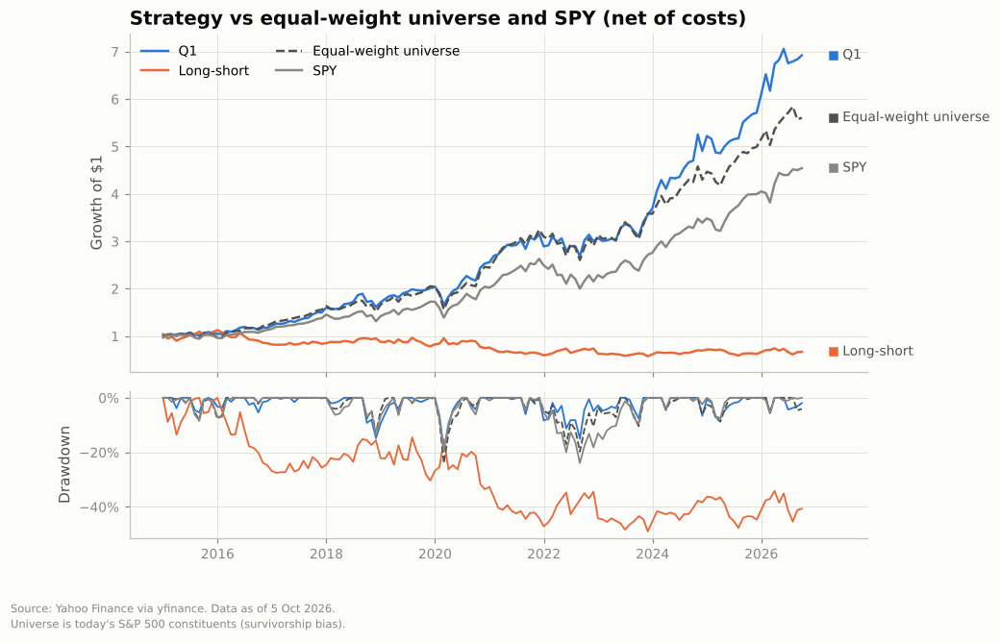

# Multi-Factor Equity Screener

[](https://github.com/FleximusRex/Finance-equity-scanner/actions/workflows/ci.yml)
[](https://fleximusrex.github.io/Finance-equity-scanner/)
[](https://colab.research.google.com/github/FleximusRex/Finance-equity-scanner/blob/main/notebooks/multi_factor_equity_screener.ipynb)


I built a Python pipeline that ranks US large caps on five factor categories (value, quality, momentum, growth and low volatility), backtests the price-based factors over 142 holding months from Jan 2015 to Oct 2026, and exports the results to Excel. The factors did not predict returns. On the S&P 500 the top quintile beat SPY, but an equal-weight basket of the same stocks did most of that with no model at all. The Q1 minus Q5 long-short portfolio lost 3.7% a year, and its Fama-French alpha is -2.1% a year with a Newey-West t-stat of -1.10, which is indistinguishable from zero.

Data as of 16 Nov 2026. Details are in [docs/methodology.md](docs/methodology.md), and there is an [interactive dashboard](https://fleximusrex.github.io/Finance-equity-scanner/) and a [Colab notebook](notebooks/multi_factor_equity_screener.ipynb).

## Results

Monthly rebalance, 142 holding months from Jan 2015 to Oct 2026, 503 S&P 500 stocks, 10 bps (0.10%) trading cost per side. Q1 is the 20% of stocks with the best momentum and low-volatility scores. Each score is a cross-sectional z-score: how many standard deviations a stock sits above or below the average stock on the same date. Sharpe ratios use excess returns: the portfolio's return minus the 1-month T-bill rate, which averaged 2.0% a year over the period.

| Portfolio | CAGR | Sharpe (excess return) | Max drawdown |
|---|---|---|---|
| Q1 (top quintile), net of costs | 17.9% | 1.03 | -19.1% |
| Equal-weight universe | 16.2% | 0.90 | -23.8% |
| SPY | 13.5% | 0.79 | -23.9% |



The equal-weight basket of the same stocks beat SPY by 2.7 points a year with no factor model at all. That gap comes from survivorship bias: the list is today's index members, so the companies that failed or were dropped since 2015 are missing. Q1 beat the basket by 1.7 points, but the factors themselves show no detectable predictive power:

- The composite's mean rank IC is -0.004 (t = -0.23, p = 0.82). The rank IC is the correlation between how the model ranked the stocks at a month-end and how their returns ranked over the next month.
- The Q1 minus Q5 long-short portfolio, which buys the top quintile and shorts the bottom one so that the market's move cancels out, lost 3.7% a year after costs. This quintile spread is the cleanest test of the ranking.
- I tested five signals. The lowest p-value was 0.18, for 60-day volatility, and it had the wrong sign: volatile stocks beat calm ones. After a Holm correction for testing five signals at once, that p-value is 0.88.

The current ranking in `outputs/sp500/rankings/rankings.csv` is led by SNDK, PSX, MPC, MU and VLO: two memory-chip makers with betas of 4.0 and 3.4, and three refiners with strong momentum. Treat it as a screen, not a recommendation.

### Is Q1 just exposure to known factors?

I regressed each portfolio's monthly excess return on the Fama-French five factors plus momentum (market, size, value, profitability, investment and UMD). The Fama-French alpha is the return per year left over after those exposures. The Newey-West t-stat is a t-stat whose standard error allows for autocorrelated and uneven monthly returns, so it does not overstate significance. The French files end in Sep 2026, so this uses the 141 months from Jan 2015 to Sep 2026.

| Portfolio | Alpha per year | Alpha t-stat | Mkt-RF | SMB | HML | RMW | CMA | UMD | R2 |
|---|---|---|---|---|---|---|---|---|---|
| Q1, net of costs | 3.9% | 2.76 | 0.93 | 0.26 | 0.06 | 0.14 | 0.06 | 0.43 | 0.83 |
| Long-short Q1 minus Q5, net | -2.1% | -1.10 | -0.24 | 0.11 | -0.07 | 0.23 | 0.07 | 1.00 | 0.80 |
| Equal-weight universe | 2.8% | 3.71 | 0.97 | 0.18 | 0.10 | 0.15 | 0.06 | -0.02 | 0.95 |

Q1's alpha of 3.9% looks significant, but the equal-weight universe, which picks nothing, has an alpha of 2.8% with an even larger t-stat. That is survivorship bias showing up as alpha. The long-short portfolio removes it, because both legs come from the same list, and its alpha is negative and not significant. Its UMD loading of 1.00 shows the ranking mostly bought the momentum factor that anyone can already get from an index.

### Robustness checks

From `outputs/sp500/robustness.csv` and the sector-neutral run:

- **Costs.** At 50 bps per side, Q1 returns 15.1% a year against 15.9% for the equal-weight basket, so its lead disappears.
- **Sub-periods.** The long-short portfolio lost money in all three periods: -4.3% a year in 2015-2019, -1.2% in 2020-2022 and -4.9% from 2023 to Oct 2026.
- **Execution lag.** Trading at the close one day after the signal lowers Q1 from 17.9% to 17.0% a year and the long-short from -3.7% to -5.3%.
- **Sector-neutral.** Z-scoring within GICS sector lifts the long-short to -2.6% a year, and the composite IC is 0.002 (p = 0.90). Still nothing.

The S&P 100 gives the same answer: a composite IC of -0.001 (p = 0.97), a long-short return of -1.9% a year, and a long-short Fama-French alpha of -2.6% (t = -0.75).

## Install

```bash
git clone https://github.com/FleximusRex/Finance-equity-scanner.git
cd Finance-equity-scanner
python -m venv .venv && source .venv/bin/activate   # Python 3.11 or newer
make setup
```

`make setup` installs `requirements.txt` plus ruff. To skip installing anything, open the Colab notebook from the badge above and choose Runtime, then Run all. The default S&P 100 run takes a few minutes and needs no restart.

## Usage

```bash
make all UNIVERSE=sp100   # ranking, backtest, sector-neutral run, charts and Excel for one universe
make dashboard            # builds docs/index.html from outputs/ (no downloads)

make rank                 # current ranking, writes outputs/sp500/rankings/rankings.csv
make backtest             # backtest, factor tests, Fama-French regression and robustness table
make sector-neutral       # the same with z-scores within sector, in outputs/sp500/sector_neutral/
make charts               # charts in outputs/sp500/charts/
make excel                # outputs/sp500/equity_screener_<as-of date>.xlsx
make test                 # unit tests
make lint                 # ruff

python -m src.rank --universe test50       # the same without make
python -m src.report AAPL                  # factor profile for one stock
```

Each command takes `--universe {test50,sp100,sp500}`. If the flag is left out, the `UNIVERSE_MODE` environment variable is used, and then `sp500`.

| Universe | What it is | Outputs |
|---|---|---|
| `test50` | 50 large caps I picked across sectors | `outputs/test50/` |
| `sp100` | The S&P 100, the 100 largest blue-chip US companies, from Wikipedia | `outputs/sp100/` |
| `sp500` | The S&P 500, from Wikipedia | `outputs/sp500/` |

The first run downloads and caches data in `data/cache/`. Each run writes `run_info.json` with the as-of date, ticker count, holding months and git commit, and the charts, dashboard and Excel file read the date from there. To regenerate everything, run `make all` for each universe and then `make dashboard`. The price download is pinned to end on 16 Nov 2026 in `src/config.py`. Yahoo revises adjusted prices and the ranking uses current fundamentals, so a rerun matches the saved numbers only approximately.

## Excel export

`make excel` writes one workbook per universe with these sheets: Rankings (frozen header, number formats and a red-to-blue color scale on the factor scores), Backtest Summary, Factor Tests, FF Regression, Robustness, Sector Neutral, Monthly Returns and Notes (a short methodology and the as-of date). The S&P 500 file is [`outputs/sp500/equity_screener_2026-11-16.xlsx`](outputs/sp500/equity_screener_2026-11-16.xlsx). The Colab notebook builds the same file and downloads it.

## Repository structure

```
src/
  config.py          dates, universes, factor weights, costs, paths
  cli.py             --universe and --sector-neutral flags shared by the commands
  universe.py        50-stock list, or S&P 100 and S&P 500 from Wikipedia (cached)
  data_loader.py     cached yfinance prices and fundamentals, retries
  french.py          Fama-French factors and the T-bill rate from Kenneth French's library
  factors.py         raw price and fundamental metrics
  scoring.py         winsorizing, z-scores (universe-wide or within sector), composite
  rank.py            current ranking
  backtest.py        monthly quintile backtest, costs, factor tests, robustness table
  performance.py     CAGR, excess-return Sharpe, drawdown, alpha and beta, rank IC, Holm
  ff_regression.py   Fama-French five-factor plus momentum regression
  run_info.py        as-of date and run details saved next to the outputs
  visualization.py   charts
  excel_export.py    Excel workbook
  report.py          single-stock report
  dashboard.py       builds docs/index.html from outputs/
tests/               unit tests, none of which use the network
notebooks/           Colab notebook with saved outputs (S&P 100 run)
outputs/<universe>/  rankings, backtest and factor tables, charts, Excel file
docs/                dashboard (index.html) and methodology.md
```

## Data sources

| Data | Source | Cache |
|---|---|---|
| Adjusted daily prices from 2014 | Yahoo Finance via `yfinance` | `data/cache/prices_*.parquet` |
| Current fundamentals | Yahoo Finance via `yfinance` | `data/cache/fundamentals.parquet` |
| S&P 500 and S&P 100 constituents and GICS sectors | Wikipedia ([S&P 500](https://en.wikipedia.org/wiki/List_of_S%26P_500_companies), [S&P 100](https://en.wikipedia.org/wiki/S%26P_100)) | `data/cache/sp*_constituents.parquet` |
| Fama-French factors and the 1-month T-bill rate | [Kenneth French data library](https://mba.tuck.dartmouth.edu/pages/faculty/ken.french/data_library.html) | `data/cache/french_factors.parquet` |
| T-bill rate for months after the French file ends | Yahoo `^IRX` (13-week T-bill) | `data/cache/prices_*.parquet` |

A ticker with bad or missing data is logged and skipped rather than stopping the run.

## Limitations

- Fundamentals are current values, not point-in-time (the values an investor could actually have seen on each date), so value, quality and growth appear in the ranking but cannot be backtested. The historical test uses momentum and low volatility only.
- Every universe is today's tickers, so delisted and acquired companies are missing. Compare the quintiles with the equal-weight basket, not with SPY.
- Sector labels are today's, not historical, so the sector-neutral run uses some hindsight.
- Yahoo Finance is an unofficial source and can be wrong or change between downloads.
- Trading is simplified: month-end closes, flat costs per side, equal weights, and no borrow costs on the short leg. Turnover, the share of the portfolio traded each month, averaged 25.3% one way for Q1.

[docs/methodology.md](docs/methodology.md) has the full list, the factor definitions and the complete result tables.

## Disclaimer

This project is for education and research and is not investment advice. Backtested results are hypothetical, are affected by the biases above, and do not predict future returns.

## License

[MIT](LICENSE)

Built by Sawyer Cross, B.S.B.A. Finance student at the University of West Florida. [GitHub](https://github.com/FleximusRex)
