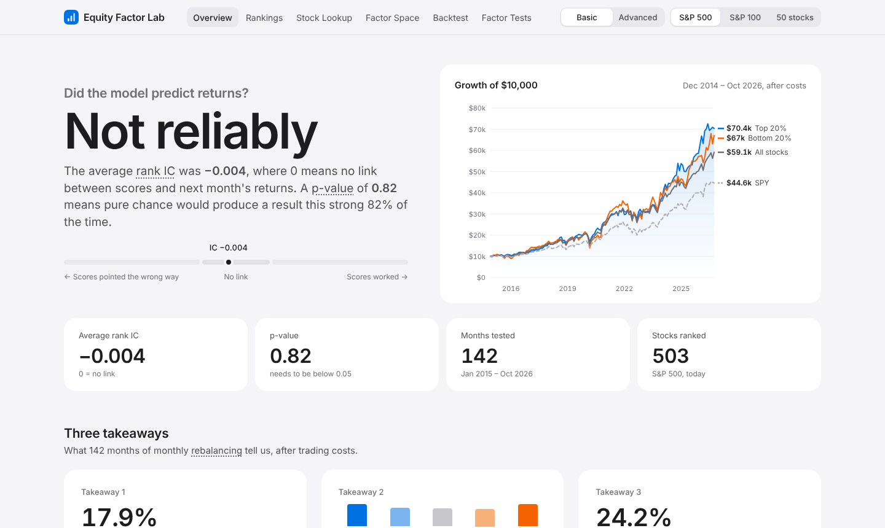

# Multi-Factor Equity Screener

[](https://github.com/FleximusRex/Finance-equity-scanner/actions/workflows/ci.yml)
[](https://fleximusrex.github.io/Finance-equity-scanner/)
[](https://colab.research.google.com/github/FleximusRex/Finance-equity-scanner/blob/main/notebooks/multi_factor_equity_screener.ipynb)


I built a Python pipeline that ranks the S&P 500 on five factor categories (value, quality, momentum, growth and low volatility) and tests whether the price-based factors predicted next-month returns from 2014 to 2026. They did not. No price factor was statistically significant, and about half of the top quintile's lead over SPY also shows up in a plain equal-weight basket of the same stocks, which points to survivorship bias from testing today's index members against history.

Data as of 5 Oct 2026. Details are in [docs/methodology.md](docs/methodology.md), and there is an [interactive dashboard](https://fleximusrex.github.io/Finance-equity-scanner/) and a [Colab notebook](notebooks/multi_factor_equity_screener.ipynb).

[](https://fleximusrex.github.io/Finance-equity-scanner/)

## Results

Monthly rebalance, Dec 2014 to Sep 2026 (142 months), 503 S&P 500 stocks, 10 bps trading cost per side. Q1 is the 20% of stocks with the best momentum and low-volatility scores. Sharpe ratios use a 0% risk-free rate.

| Portfolio | CAGR | Sharpe | Max drawdown |
|---|---|---|---|
| Q1 (top quintile), net of costs | 17.8% | 1.16 | -19.1% |
| Equal-weight universe | 15.7% | 1.00 | -24.0% |
| SPY | 13.7% | 0.94 | -23.9% |


Q1 beat SPY by 4.1 points a year. The equal-weight basket of the same stocks beat SPY by 2.0 points with no factor model at all, so that part of the lead comes from the universe. Q1 beat the basket by 2.1 points, but the factors themselves show no detectable predictive power:

- The composite's mean rank IC is -0.003 (t = -0.17, p = 0.87).
- The Q1 minus Q5 long-short portfolio lost 3.3% a year after costs.
- The best single factor was beta, and it had the wrong sign: high-beta stocks beat low-beta stocks (t = -1.59, p = 0.11).

The current ranking in `outputs/sp500/rankings/rankings.csv` is dominated by extreme-momentum names. MU, SNDK and WDC have momentum z-scores between 3.0 and 5.0 and betas between 2.9 and 4.1. Treat it as a screen, not a recommendation.

## Install

```bash
git clone https://github.com/FleximusRex/Finance-equity-scanner.git
cd Finance-equity-scanner
python -m venv .venv && source .venv/bin/activate   # Python 3.11 or newer
make setup
```

`make setup` installs `requirements.txt` plus ruff. To skip installing anything, open the Colab notebook from the badge above and choose Runtime, then Run all. It takes a minute or two and needs no restart.

## Usage

```bash
make rank        # current ranking, writes outputs/sp500/rankings/rankings.csv
make backtest    # backtest and factor tests, writes backtest_*.csv and factor_tests.csv
make charts      # charts in outputs/sp500/charts/
make dashboard   # builds docs/index.html from outputs/ (no downloads)
make test        # unit tests
make lint        # ruff

make backtest UNIVERSE=test50              # the 50-stock test set
python -m src.rank --universe test50       # the same without make
python -m src.report AAPL                  # factor profile for one stock
```

Each command takes `--universe {sp500,test50}`. If the flag is left out, the `UNIVERSE_MODE` environment variable is used, and then `sp500`. The first run downloads and caches data in `data/cache/`.

To regenerate every file in `outputs/` and the dashboard, run `make rank backtest charts dashboard`. The price download is pinned to 5 Oct 2026 in `src/config.py`. Yahoo revises adjusted prices and the ranking uses current fundamentals, so a rerun matches the saved numbers only approximately.

## Repository structure

```
src/
  config.py          dates, universe, factor weights, costs, paths
  cli.py             --universe flag shared by the commands
  universe.py        50-stock list or S&P 500 from Wikipedia (cached)
  data_loader.py     cached yfinance prices and fundamentals, retries
  factors.py         raw price and fundamental metrics
  scoring.py         winsorizing, z-scores, category and composite scores
  rank.py            current ranking
  backtest.py        monthly quintile backtest, costs, single-factor tests
  performance.py     CAGR, Sharpe, drawdown, alpha and beta, rank IC
  visualization.py   charts
  report.py          single-stock report
  dashboard.py       builds docs/index.html from outputs/ and the template
  dashboard_template.html  the dashboard's HTML, CSS and JS (edit this, not docs/index.html)
tests/               unit tests, none of which use the network
notebooks/           Colab notebook with saved outputs (50-stock run)
outputs/sp500/       rankings, backtest and factor tables, charts
outputs/test50/      the same tables for the 50-stock set
docs/                built dashboard (index.html, generated), preview image and methodology.md
```

## Data sources

| Data | Source | Cache |
|---|---|---|
| Adjusted daily prices from 2014 | Yahoo Finance via `yfinance` | `data/cache/prices_*.parquet` |
| Current fundamentals | Yahoo Finance via `yfinance` | `data/cache/fundamentals.parquet` |
| S&P 500 constituents | [Wikipedia](https://en.wikipedia.org/wiki/List_of_S%26P_500_companies) | `data/cache/sp500_constituents.parquet` |

A ticker with bad or missing data is logged and skipped rather than stopping the run.

## Limitations

- Fundamentals are current values, not point-in-time, so value, quality and growth appear in the ranking but cannot be backtested. The historical test uses momentum and low volatility only.
- Both universes are today's tickers, so delisted and acquired companies are missing. Compare the quintiles with the equal-weight basket, not with SPY.
- Yahoo Finance is an unofficial source and can be wrong or change between downloads.
- Trading is simplified: month-end closes, flat 10 bps costs, and no borrow costs on the short leg.

[docs/methodology.md](docs/methodology.md) has the full list, the factor definitions and the complete result tables.

## Disclaimer

This project is for education and research and is not investment advice. Backtested results are hypothetical, are affected by the biases above, and do not predict future returns.

## License

[MIT](LICENSE)

Built by Sawyer Cross, B.S.B.A. Finance student at the University of West Florida. [GitHub](https://github.com/FleximusRex)
