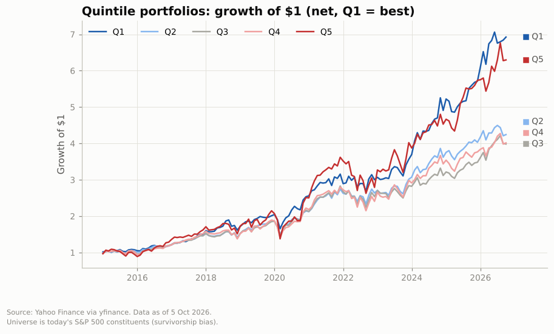
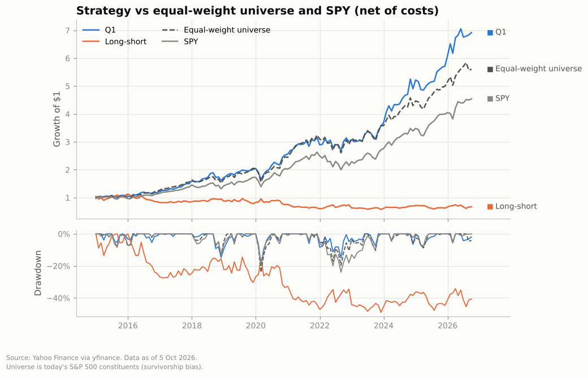
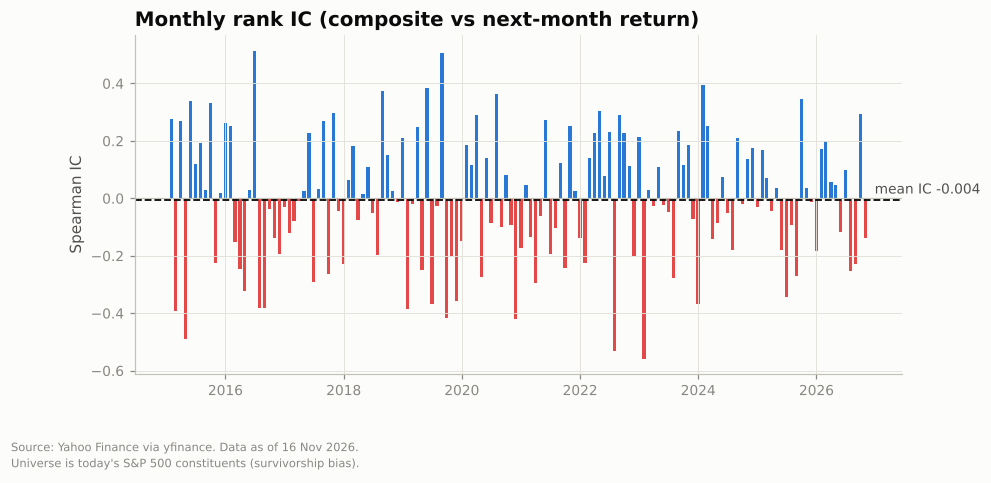
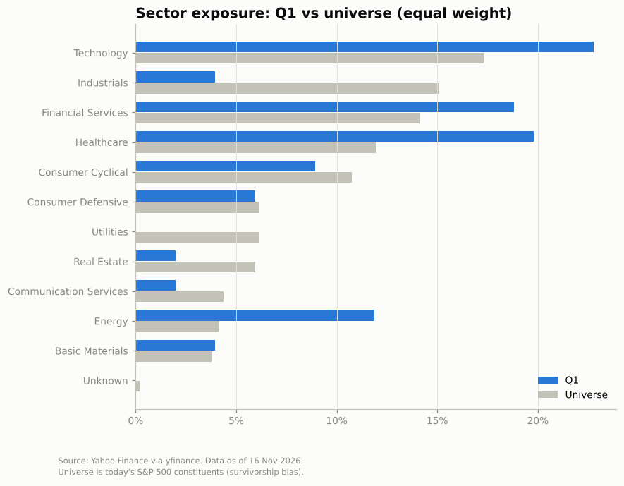

# Methodology and detailed results

This page holds the detail behind the [README](../README.md): how the factors are built, how the backtest works, the full result tables and the limitations. Every number comes from the CSV files in [`outputs/`](../outputs/). Data as of 5 Oct 2026.

## Research question

Do simple price-based factors (12-1 month momentum, 6-month momentum, 60-day volatility and beta) predict the next month's cross-section of US large-cap returns, alone or combined, after transaction costs?

The main test is the rank information coefficient (IC). Each month I take the Spearman correlation between the factor score and the following month's return, average it over 142 months and t-test the average against zero. Quintile and long-short returns are a second view of the same question.

## Factors

The screener scores 12 metrics in five categories. A higher score is better, so metrics where lower is better are inverted.

| Category | Metrics | Source | In the backtest |
|---|---|---|---|
| Value | Earnings yield, FCF yield, EV/EBITDA (inverted) | yfinance fundamentals | No |
| Quality | ROE, gross margin, debt/equity (inverted) | yfinance fundamentals | No |
| Momentum | 12-1 month return, 6-month return | Prices | Yes |
| Low volatility | 60-day volatility (inverted), 252-day beta vs SPY (inverted) | Prices | Yes |
| Growth | Revenue growth, earnings growth | yfinance fundamentals | No |

Price factors are computed at each rebalance date from prices up to that date only. A unit test shocks all later prices and checks that the factors do not change. Stocks with fewer than 252 days of history are excluded.

## Scoring

1. Winsorize each metric across stocks at the 1st and 99th percentiles.
2. Z-score each metric across stocks, then flip the sign where lower is better.
3. A category score is the mean of the available metric z-scores in that category.
4. The composite is a weighted sum of the category scores: value 25%, quality 25%, momentum 25%, growth 15%, low volatility 10%. If a stock is missing a category, the remaining weights are rescaled.
5. Q1 is the top 20% of stocks by composite and Q5 is the bottom 20%.

## Backtest

- Rebalance on the last trading day of each month. Stocks are equal-weighted within each quintile.
- The historical composite uses only momentum and low volatility, rescaled to their weights of 25% and 10%, because the fundamentals are not point-in-time.
- Costs are 10 bps of traded notional. Turnover is measured against the previous weights after they have drifted with returns. The long-short portfolio pays costs on both legs.
- Statistics are CAGR, volatility, Sharpe ratio, maximum drawdown, beta and alpha against SPY, information ratio, turnover and rank IC. The Sharpe ratio, Sortino ratio and alpha use a 0% risk-free rate.
- I also run the same backtest on each price factor alone and on the composite (`outputs/*/factor_tests.csv`).

Data flow: `universe.py` picks the tickers, `data_loader.py` downloads and caches prices and fundamentals, `factors.py` turns them into raw metrics and `scoring.py` standardizes and combines them. `rank.py` writes the current ranking and `backtest.py` writes the backtest and factor tests, using `performance.py` for the statistics. `visualization.py` and `dashboard.py` read the saved CSVs and never download anything.

## Charts

These come from the S&P 500 run and are saved in [`outputs/sp500/charts/`](../outputs/sp500/charts/).

| | |
|---|---|
|  |  |
|  |  |
|  |  |
|  | |

## Results: S&P 500 universe

Price-factor composite, net of costs unless marked gross. 142 monthly rebalances from Dec 2014 to Sep 2026, 503 tickers. Source: `outputs/sp500/backtest_summary.csv`.

| Portfolio | CAGR | Ann. vol | Sharpe | Max DD | Beta | Alpha | Info ratio | Avg turnover |
|---|---|---|---|---|---|---|---|---|
| Q1 (highest scores) | 17.8% | 15.2% | 1.16 | -19.1% | 0.86 | 5.7% | 0.42 | 25.3% |
| Q2 | 13.0% | 13.9% | 0.95 | -19.6% | 0.84 | 1.5% | -0.11 | 47.4% |
| Q3 | 12.4% | 15.4% | 0.84 | -21.7% | 0.97 | -0.6% | -0.19 | 51.6% |
| Q4 | 12.5% | 17.3% | 0.77 | -25.5% | 1.06 | -1.5% | -0.09 | 45.4% |
| Q5 (lowest scores) | 16.8% | 23.3% | 0.79 | -35.9% | 1.38 | -0.9% | 0.35 | 23.4% |
| Long-short Q1 minus Q5, net | -3.3% | 17.4% | -0.11 | -49.0% | -0.52 | 5.5% | -0.58 | 48.7% |
| Long-short Q1 minus Q5, gross | -2.2% | 17.4% | -0.04 | -44.0% | -0.52 | 6.6% | -0.53 | 48.7% |
| Equal-weight universe | 15.7% | 16.0% | 1.00 | -24.0% | 1.02 | 1.7% | 0.39 | 3.1% |
| SPY | 13.7% | 14.9% | 0.94 | -23.9% | 1.00 | 0.0% | n/a | n/a |

Q1 has a better Sharpe ratio than Q5 (1.16 against 0.79) and a shallower drawdown, which is what a lower-beta tilt would produce. Returns do not rise steadily from Q5 to Q1, though: Q5 beat Q2 to Q4, and the long-short spread is negative. Every quintile and the equal-weight basket benefit from survivorship bias, so beating SPY says little. The fair baseline for Q1 (17.8%) is the equal-weight basket (15.7%).

## Single-factor IC tests

Each price factor is backtested alone, signed so that a higher score should mean a higher return. Mean IC is the average monthly Spearman rank correlation. CAGRs are net of costs. Sources: `outputs/sp500/factor_tests.csv` and `outputs/test50/factor_tests.csv`.

S&P 500 (503 tickers):

| Signal | Mean IC | t-stat | p-value | Q1 CAGR | Q5 CAGR | Long-short CAGR |
|---|---|---|---|---|---|---|
| 12-1 month momentum | 0.004 | 0.26 | 0.80 | 20.1% | 15.5% | 0.5% |
| 6-month momentum | 0.005 | 0.33 | 0.75 | 20.0% | 15.4% | 0.5% |
| 60-day volatility (low is better) | -0.029 | -1.49 | 0.14 | 10.5% | 26.7% | -17.5% |
| 252-day beta (low is better) | -0.037 | -1.59 | 0.11 | 10.1% | 25.1% | -17.0% |
| Composite (momentum + low vol) | -0.003 | -0.17 | 0.87 | 17.8% | 16.8% | -3.3% |

50-stock test universe:

| Signal | Mean IC | t-stat | p-value | Q1 CAGR | Q5 CAGR | Long-short CAGR |
|---|---|---|---|---|---|---|
| 12-1 month momentum | 0.014 | 0.63 | 0.53 | 24.4% | 19.3% | 0.3% |
| 6-month momentum | 0.029 | 1.34 | 0.18 | 23.2% | 14.7% | 3.5% |
| 60-day volatility (low is better) | -0.045 | -1.85 | 0.067 | 10.2% | 27.6% | -18.4% |
| 252-day beta (low is better) | -0.054 | -1.87 | 0.063 | 11.6% | 28.9% | -18.7% |
| Composite (momentum + low vol) | 0.003 | 0.14 | 0.89 | 20.1% | 16.8% | -1.6% |

What the tests show:

1. No factor is significant at the 5% level in either universe. The lowest p-value is 0.063, for beta in the 50-stock set.
2. Momentum is flat. On the S&P 500, Q1 and Q5 CAGRs differ by about 4.6 points, but the long-short portfolio compounds at only 0.5% a year and the IC is close to zero (p of 0.75 to 0.80).
3. Low volatility has the wrong sign. High-volatility and high-beta stocks did better, and the long-short portfolio lost about 17% a year. I suspect a bull market led by high-beta technology stocks, and survivorship inflates this further, since volatile stocks still in the index today are the ones that went up.
4. The composite cancels out. Momentum is slightly positive and inverted low volatility is negative, which leaves a composite IC of about zero.
5. The 50-stock results are noisier. Every single-factor t-stat is smaller in absolute value on the S&P 500 than on the 50 stocks. The composite is the exception (0.17 against 0.14).

## 50 stocks against the S&P 500

| Price-factor composite | 50 stocks | S&P 500 |
|---|---|---|
| Universe size | 50 | 503 |
| Q1 CAGR (net) | 20.1% | 17.8% |
| Q5 CAGR (net) | 16.8% | 16.8% |
| Equal-weight universe CAGR | 18.0% | 15.7% |
| SPY CAGR | 13.7% | 13.7% |
| Q1 Sharpe | 1.18 | 1.16 |
| Q1 minus equal-weight CAGR | +2.1 points | +2.1 points |
| Long-short CAGR (net) | -1.6% | -3.3% |
| Composite mean IC (t, p) | 0.003 (0.14, 0.89) | -0.003 (-0.17, 0.87) |
| Best single factor | beta, t = -1.87 (p = 0.063) | beta, t = -1.59 (p = 0.11) |

The 50 large caps I picked carry the most survivorship bias. Their equal-weight basket beat SPY by 4.3 points a year after costs with no factor model at all. With the full index the gap falls to 2.0 points and the single-factor signals get weaker. The conclusion is the same in both universes: no significant predictive power, and low volatility had the wrong sign over this period.

## Limitations

- yfinance only gives current fundamentals, so value, quality and growth cannot be backtested without look-ahead. They appear in the current ranking only.
- Both universes are today's tickers projected back to 2014. Companies that were delisted, acquired or dropped from the index are missing, which inflates absolute returns, especially for volatile names. Compare quintiles with each other and with the equal-weight basket rather than with SPY.
- Yahoo Finance is an unofficial and rate-limited source. Fields can be missing or wrong (debt/equity units and negative equity are two cases I hit), and adjusted prices can change between downloads. A rerun can differ from the saved outputs in the last digits.
- The long-short portfolio pays 10 bps on both legs but no borrow fees, short rebates or margin costs.
- Trades happen at the month-end close with equal weights. There is no market impact, capacity limit, sector or beta neutralization, or risk model.
- There are 142 monthly observations, the factor definitions overlap, and I tested several factors without a multiple-testing correction. A p-value of 0.06 should be read as no evidence, not as nearly significant.
- Sharpe ratios, Sortino ratios and alpha ignore the risk-free rate. Using actual T-bill rates would lower the Sharpe ratios.

## Possible extensions

- Point-in-time fundamentals (Compustat, or SEC EDGAR filings with filing-date lags) so value, quality and growth can be backtested.
- Index membership by date, including delisted names, to remove survivorship bias.
- Sector and beta neutral portfolios, and a regression on Fama-French factors to separate alpha from known exposures.
- A multiple-testing correction such as the Harvey, Liu and Zhu hurdle of t > 3, and bootstrap confidence intervals for the IC.
- Short borrow costs and a market impact model.
