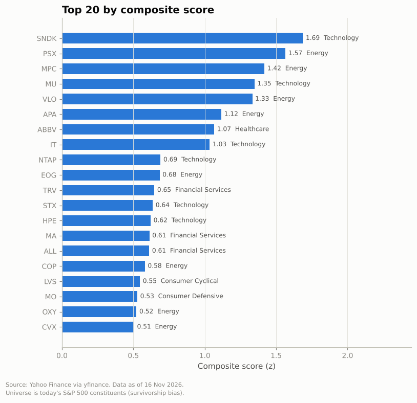
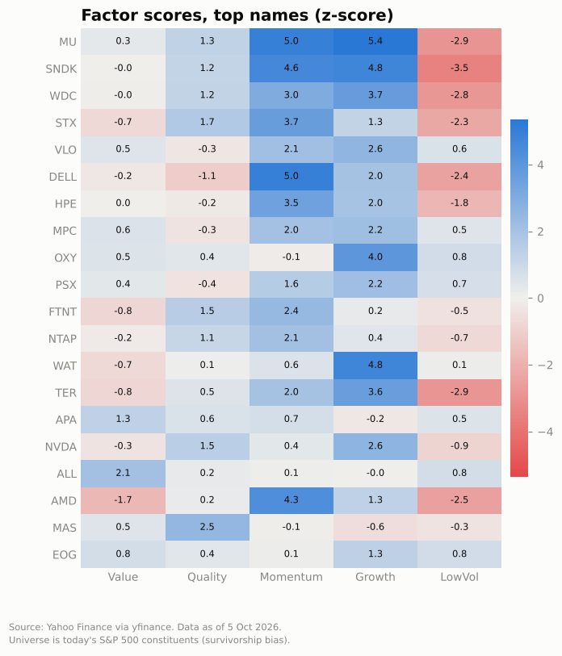
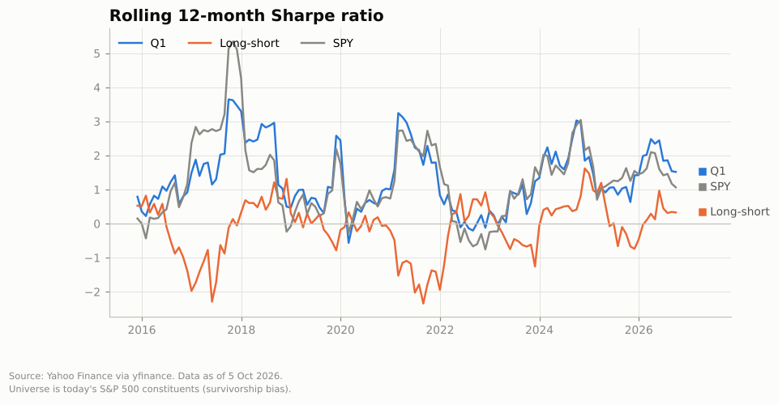

# Methodology and detailed results

This page holds the detail behind the [README](../README.md): how the factors are built, how the backtest works, the full result tables and the limitations. Every number comes from the files in [`outputs/`](../outputs/). Data as of 16 Nov 2026 (the date is saved in `outputs/<universe>/run_info.json`).

## Research question

Do simple price-based factors (12-1 month momentum, 6-month momentum, 60-day volatility and beta) predict the next month's cross-section of US large-cap returns, alone or combined, after transaction costs, and is anything left once known risk factors are accounted for?

The main test is the rank information coefficient (IC). Each month-end I take the Spearman correlation between the factor score and the following month's return, average it over 142 holding months and t-test the average against zero. Quintile and long-short returns are a second view of the same question, and the Fama-French regression is a third.

## Universes

| Universe | Source | Tickers with prices |
|---|---|---|
| `test50` | 50 large caps I picked across sectors (`src/config.py`) | 50 |
| `sp100` | The `constituents` table (columns Symbol, Name, Sector) in Wikipedia's "S&P 100" article | 101 |
| `sp500` | The `constituents` table (columns Symbol, Security, GICS Sector) in Wikipedia's "List of S&P 500 companies" article | 503 |

The S&P 100 has 101 tickers because Alphabet has two share classes. Class shares are converted to Yahoo's format (BRK.B becomes BRK-B). Both lists are cached in `data/cache/` after the first download, and the parsing is tested offline against small HTML fixtures.

## Factors

The screener scores 12 metrics in five categories. A higher score is better, so metrics where lower is better are inverted.

| Category | Metrics | Source | In the backtest |
|---|---|---|---|
| Value | Earnings yield, FCF yield, EV/EBITDA (inverted) | yfinance fundamentals | No |
| Quality | ROE, gross margin, debt/equity (inverted) | yfinance fundamentals | No |
| Momentum | 12-1 month return, 6-month return | Prices | Yes |
| Low volatility | 60-day volatility (inverted), 252-day beta vs SPY (inverted) | Prices | Yes |
| Growth | Revenue growth, earnings growth | yfinance fundamentals | No |

Price factors are computed at each rebalance date from prices up to that date only. A unit test shocks all later prices and checks that the factors do not change. Stocks with fewer than 252 days of history are excluded. The 12-1 momentum signal skips the most recent month, because one-month returns tend to reverse, and needs a year of history, so it has 141 months of results rather than 142.

## Scoring

1. Winsorize each metric across stocks at the 1st and 99th percentiles.
2. Z-score each metric across stocks (a cross-sectional z-score), then flip the sign where lower is better.
3. A category score is the mean of the available metric z-scores in that category.
4. The composite is a weighted sum of the category scores: value 25%, quality 25%, momentum 25%, growth 15%, low volatility 10%. If a stock is missing a category, the remaining weights are rescaled.
5. Q1 is the top 20% of stocks by composite and Q5 is the bottom 20%.

### Sector-neutral option

With `--sector-neutral` (or `make sector-neutral`), step 2 computes each z-score within the stock's GICS sector instead of across the whole universe, so a stock is compared only with its sector peers and the quintiles no longer load up on one sector. A sector with fewer than 5 scored names keeps the universe-wide z-score, because a mean and standard deviation from two or three stocks are unstable. In the S&P 100, Materials and Real Estate have one name each and Energy and Utilities have three, so those fall back. The results go to `outputs/<universe>/sector_neutral/`.

The sector labels come from today's Wikipedia table, not from history. A company that changed sector (for example in the 2018 GICS reshuffle that created Communication Services) is treated as if it had always been in its current one.

## Backtest

- Rebalance on the last trading day of each complete month. Stocks are equal-weighted within each quintile and held for the following month. Each row of `backtest_monthly_returns.csv` is labelled with the month the return was earned in, so the first row (Jan 2015) uses a signal from the 31 Dec 2014 close.
- The historical composite uses only momentum and low volatility, rescaled to their weights of 25% and 10%, because the fundamentals are not point-in-time.
- Costs are 10 bps of traded notional per side. Turnover is measured against the previous weights after they have drifted with returns. The long-short portfolio pays costs on both legs.
- Statistics are CAGR, volatility, Sharpe and Sortino ratios, maximum drawdown, beta and alpha against SPY, information ratio, turnover and rank IC.
- I also run the same backtest on each price factor alone and on the composite (`factor_tests.csv`).

Data flow: `universe.py` picks the tickers, `data_loader.py` downloads and caches prices and fundamentals, `factors.py` turns them into raw metrics and `scoring.py` standardizes and combines them. `rank.py` writes the current ranking and `backtest.py` writes the backtest, factor tests, Fama-French regression and robustness table, using `performance.py`, `french.py` and `ff_regression.py`. `run_info.py` records the as-of date. `visualization.py`, `excel_export.py`, `database.py` and `dashboard.py` read the saved files and never download prices.

### Partial final month

Version 0.1 counted a partial month as a full one. The price download ended on 5 Oct 2026, so the code treated 5 Oct as October's month-end, and the last holding period ran from 30 Sep to 5 Oct: three trading days that CAGR, the Sharpe ratio and the t-tests all counted as a month. `rebalance_dates()` now drops the last month if the data stops before its final business day, so the backtest only holds through the last complete month-end. With prices through 16 Nov 2026, the ranking uses the 16 Nov close and the backtest ends with October 2026. A unit test builds a price index that ends on 5 Jul 2024 and checks that the results match the same index cut at 30 Jun.

### Risk-free rate

Version 0.1 used a 0% risk-free rate. Sharpe, Sortino, beta and alpha now use excess returns: the monthly return minus the 1-month T-bill rate (the `RF` column in Kenneth French's data library). The French file ended in Sep 2026, so for October 2026 I use Yahoo's `^IRX` (the 13-week T-bill yield, in annualized percent). The yield at the end of September divided by 12 is October's rate, because a bill bought at the end of one month earns that yield over the next. The rate averaged 2.0% a year over the 142 months and was 0.34% for October 2026. The long-short portfolio is self-financing (the short pays for the long), so its return is already an excess return and nothing is subtracted. CAGR and maximum drawdown are total returns and do not change.

### SQL queries

`database.py` copies four result files into a SQLite database (`rankings`, `monthly_returns`, `backtest_summary` and `factor_tests` tables) and runs each file in [`sql/`](../sql/) in name order. The queries only read what the backtest already produced; they do not compute any of the statistics above. The sector labels in `rankings` are Yahoo's (for example "Healthcare"), not the GICS labels from Wikipedia that the sector-neutral option uses.

## Charts

These come from the S&P 500 run and are saved in [`outputs/sp500/charts/`](../outputs/sp500/charts/). Charts for the other universes are in their own folders.

| | |
|---|---|
|  |  |
|  |  |
|  |  |
|  | |

## Results: S&P 500 universe

Price-factor composite, net of costs unless marked gross. 142 holding months from Jan 2015 to Oct 2026, 503 tickers. Sharpe ratio and alpha use excess returns. Source: `outputs/sp500/backtest_summary.csv`.

| Portfolio | CAGR | Ann. vol | Sharpe | Max DD | Beta | Alpha | Info ratio | Avg turnover |
|---|---|---|---|---|---|---|---|---|
| Q1 (highest scores) | 17.9% | 15.3% | 1.03 | -19.1% | 0.86 | 5.6% | 0.46 | 25.3% |
| Q2 | 13.5% | 13.9% | 0.83 | -19.5% | 0.83 | 1.8% | -0.02 | 47.3% |
| Q3 | 13.2% | 15.6% | 0.74 | -21.8% | 0.96 | 0.3% | -0.03 | 51.4% |
| Q4 | 13.0% | 17.3% | 0.68 | -25.1% | 1.05 | -0.7% | -0.01 | 45.3% |
| Q5 (lowest scores) | 17.4% | 23.3% | 0.72 | -35.8% | 1.37 | 0.7% | 0.41 | 23.3% |
| Long-short Q1 minus Q5, net | -3.7% | 17.5% | -0.13 | -47.4% | -0.51 | 3.8% | -0.59 | 48.6% |
| Long-short Q1 minus Q5, gross | -2.6% | 17.5% | -0.06 | -42.3% | -0.51 | 5.0% | -0.54 | 48.6% |
| Equal-weight universe | 16.2% | 16.0% | 0.90 | -23.8% | 1.02 | 2.4% | 0.49 | 3.1% |
| SPY | 13.5% | 14.9% | 0.79 | -23.9% | 1.00 | 0.0% | n/a | n/a |

Q1 has a better Sharpe ratio than Q5 (1.03 against 0.72) and a shallower drawdown, which is what a lower-beta tilt would produce. Returns do not rise steadily from Q5 to Q1, though: Q5 beat Q2 to Q4, and the long-short spread is negative. Every quintile and the equal-weight basket benefit from survivorship bias, so beating SPY says little. The fair baseline for Q1 (17.9%) is the equal-weight basket (16.2%). The alpha column here is against SPY alone; the Fama-French regression below controls for more.

## Single-factor IC tests

Each price factor is backtested alone, signed so that a higher score should mean a higher return. Mean IC is the average monthly Spearman rank correlation. CAGRs are net of costs. Testing five signals raises the chance that one clears p < 0.05 by luck, so the Holm column adjusts each p-value for the number of tests: the smallest p-value is multiplied by 5, the next by 4, and so on, and an adjusted value is never allowed to fall below the one before it. Sources: `outputs/sp500/factor_tests.csv` and `outputs/sp100/factor_tests.csv`.

S&P 500 (503 tickers):

| Signal | Mean IC | t-stat | p-value | Holm p-value | Q1 CAGR | Q5 CAGR | Long-short CAGR |
|---|---|---|---|---|---|---|---|
| 12-1 month momentum | 0.001 | 0.08 | 0.94 | 1.00 | 19.8% | 16.2% | -0.4% |
| 6-month momentum | 0.003 | 0.15 | 0.88 | 1.00 | 19.9% | 16.4% | -0.4% |
| 60-day volatility (low is better) | -0.026 | -1.36 | 0.18 | 0.88 | 11.2% | 26.2% | -16.6% |
| 252-day beta (low is better) | -0.031 | -1.34 | 0.18 | 0.88 | 11.2% | 24.2% | -15.7% |
| Composite (momentum + low vol) | -0.004 | -0.23 | 0.82 | 1.00 | 17.9% | 17.4% | -3.7% |

S&P 100 (101 tickers):

| Signal | Mean IC | t-stat | p-value | Holm p-value | Q1 CAGR | Q5 CAGR | Long-short CAGR |
|---|---|---|---|---|---|---|---|
| 12-1 month momentum | 0.008 | 0.40 | 0.69 | 1.00 | 25.6% | 19.8% | 1.1% |
| 6-month momentum | 0.019 | 1.02 | 0.31 | 0.92 | 26.9% | 17.7% | 4.1% |
| 60-day volatility (low is better) | -0.046 | -2.03 | 0.044 | 0.22 | 11.4% | 33.1% | -21.9% |
| 252-day beta (low is better) | -0.052 | -1.95 | 0.053 | 0.22 | 11.7% | 32.7% | -22.0% |
| Composite (momentum + low vol) | -0.001 | -0.04 | 0.97 | 1.00 | 21.7% | 19.0% | -1.9% |

What the tests show:

1. No factor is significant at the 5% level after the Holm correction in either universe. The lowest adjusted p-value is 0.22, for volatility and beta in the S&P 100.
2. The correction matters. In the S&P 100, 60-day volatility has a raw p-value of 0.044, which would pass a naive 5% test, but it is one of five tests and its adjusted p-value is 0.22. It also has the wrong sign.
3. Momentum is flat. On the S&P 500, Q1 and Q5 CAGRs differ by about 3.6 points, but the long-short portfolio loses 0.4% a year and the IC is close to zero (p of 0.88 to 0.94).
4. Low volatility has the wrong sign. High-volatility and high-beta stocks did better, and the long-short portfolio lost about 16% a year on the S&P 500. I suspect a bull market led by high-beta technology stocks, and survivorship inflates this further, since volatile stocks still in the index today are the ones that went up.
5. The composite cancels out. Momentum is slightly positive and inverted low volatility is negative, which leaves a composite IC of about zero.

## Fama-French regression

A portfolio can beat the market just by tilting toward kinds of stocks that are already known to earn more. To check, I regress each portfolio's monthly excess return on six factor returns from Kenneth French's data library: the market minus the T-bill rate (Mkt-RF), small minus big (SMB), high minus low book-to-market (HML), profitable minus unprofitable firms (RMW), conservative minus aggressive investment (CMA), and momentum, up minus down (UMD). The intercept, multiplied by 12, is the annualized Fama-French alpha. Standard errors are Newey-West (HAC) with 6 lags, which allow for autocorrelation and changing volatility in the monthly returns. The regression uses statsmodels OLS (`src/ff_regression.py`).

The French files are published with a lag of a month or two. The current files end in Sep 2026, so the regression uses only the 141 months from Jan 2015 to Sep 2026 that both datasets cover; October 2026 is left out. Q1 and the equal-weight universe have the T-bill rate subtracted. The long-short portfolio is already an excess return. Source: `outputs/<universe>/ff_regression.csv`.

S&P 500:

| Portfolio | Alpha per year | Alpha t-stat | Mkt-RF | SMB | HML | RMW | CMA | UMD | R2 |
|---|---|---|---|---|---|---|---|---|---|
| Q1, net of costs | 3.9% | 2.76 | 0.93 | 0.26 | 0.06 | 0.14 | 0.06 | 0.43 | 0.83 |
| Long-short Q1 minus Q5, net | -2.1% | -1.10 | -0.24 | 0.11 | -0.07 | 0.23 | 0.07 | 1.00 | 0.80 |
| Equal-weight universe | 2.8% | 3.71 | 0.97 | 0.18 | 0.10 | 0.15 | 0.06 | -0.02 | 0.95 |

S&P 100:

| Portfolio | Alpha per year | Alpha t-stat | Mkt-RF | SMB | HML | RMW | CMA | UMD | R2 |
|---|---|---|---|---|---|---|---|---|---|
| Q1, net of costs | 6.2% | 3.03 | 1.00 | 0.02 | 0.08 | -0.04 | 0.02 | 0.48 | 0.81 |
| Long-short Q1 minus Q5, net | -2.6% | -0.75 | -0.04 | 0.32 | -0.01 | 0.31 | 0.17 | 1.19 | 0.67 |
| Equal-weight universe | 4.7% | 8.26 | 0.97 | -0.09 | 0.09 | -0.01 | 0.05 | -0.05 | 0.96 |

How I read it:

1. The equal-weight universe is the control. It picks nothing, yet it has an alpha of 2.8% a year on the S&P 500 (t = 3.71) and 4.7% on the S&P 100 (t = 8.26). No factor model explains that, because it comes from choosing the list with hindsight: today's index members are the companies that did well enough to stay in or get added. This is survivorship bias measured in alpha terms.
2. Q1's alpha is significant (3.9% with t = 2.76 on the S&P 500), but most of it is the same survivorship alpha the control earns. The model's own contribution is the gap between Q1 and the control, and that gap is not tested here.
3. The long-short portfolio removes the shared bias, since both legs come from the same list. Its alpha is negative in both universes (-2.1% and -2.6% a year) and not significant (t = -1.10 and -0.75).
4. The loadings show what the ranking actually bought. Q1 loads 0.43 on UMD on the S&P 500 and the long-short loads 1.00, so the composite is mostly a momentum tilt that an investor could get from a momentum index. The long-short's market beta of -0.24 comes from shorting the high-beta Q5.

## Robustness checks

Each case reruns the S&P 500 composite backtest with one change. Costs are per side; the sub-periods use the base backtest at 10 bps; the one-day lag uses the month-end signal but trades at the next day's close. Sharpe ratios use excess returns. Source: `outputs/sp500/robustness.csv`.

| Case | Months | Q1 CAGR | Q1 Sharpe | Long-short CAGR | Long-short Sharpe | Equal-weight CAGR | Equal-weight Sharpe |
|---|---|---|---|---|---|---|---|
| Cost 0 bps per side | 142 | 18.6% | 1.07 | -2.6% | -0.06 | 16.3% | 0.90 |
| Cost 10 bps per side | 142 | 17.9% | 1.03 | -3.7% | -0.13 | 16.2% | 0.90 |
| Cost 25 bps per side | 142 | 16.9% | 0.97 | -5.4% | -0.23 | 16.1% | 0.89 |
| Cost 50 bps per side | 142 | 15.1% | 0.87 | -8.1% | -0.40 | 15.9% | 0.88 |
| Sub-period 2015-2019 | 60 | 15.5% | 1.23 | -4.3% | -0.19 | 15.6% | 1.16 |
| Sub-period 2020-2022 | 36 | 14.5% | 0.73 | -1.2% | 0.04 | 12.3% | 0.59 |
| Sub-period 2023 to Oct 2026 | 46 | 24.0% | 1.22 | -4.9% | -0.20 | 20.2% | 1.09 |
| One-day execution lag | 142 | 17.0% | 0.95 | -5.3% | -0.22 | 16.4% | 0.87 |

- Q1's turnover (25.3% one way a month) is about eight times the equal-weight basket's (3.1%), so costs hit it harder. At 50 bps per side, Q1 returns 15.1% a year against 15.9% for the basket.
- Q1 did not beat the basket in 2015-2019 (15.5% against 15.6%). Its lead over the whole period comes from 2020 onward.
- The long-short portfolio lost money in every sub-period and at every cost level.
- Waiting one day to trade costs Q1 0.9 points a year (17.9% to 17.0%) and pushes the long-short from -3.7% to -5.3%, so part of the small edge the ranking has sits in the first day after the signal.

## Sector-neutral results

The same backtest with z-scores computed within GICS sector. Sources: `outputs/<universe>/backtest_summary.csv` and `outputs/<universe>/sector_neutral/`.

| | S&P 500, universe-wide | S&P 500, sector-neutral | S&P 100, universe-wide | S&P 100, sector-neutral |
|---|---|---|---|---|
| Q1 CAGR (net) | 17.9% | 18.2% | 21.7% | 20.2% |
| Q1 Sharpe | 1.03 | 1.04 | 1.17 | 1.08 |
| Q5 CAGR (net) | 17.4% | 17.4% | 19.0% | 17.4% |
| Long-short CAGR (net) | -3.7% | -2.6% | -1.9% | -0.4% |
| Long-short volatility | 17.5% | 14.3% | 19.6% | 14.6% |
| Long-short beta vs SPY | -0.51 | -0.37 | -0.36 | -0.15 |
| Long-short max drawdown | -47.4% | -46.0% | -47.2% | -33.5% |
| Composite mean IC (t, p) | -0.004 (-0.23, 0.82) | 0.002 (0.13, 0.90) | -0.001 (-0.04, 0.97) | 0.006 (0.38, 0.71) |
| Long-short Fama-French alpha (t) | -2.1% (-1.10) | -2.2% (-1.19) | -2.6% (-0.75) | -2.2% (-0.91) |

Neutralizing sectors does what it should to risk: the long-short portfolio's volatility falls by about a fifth to a quarter and its market beta moves toward zero, because Q1 and Q5 no longer differ mainly by sector (for example tech against utilities). It does not create a signal. The composite IC stays within 0.01 of zero and the long-short Fama-French alpha stays negative and insignificant.

## Across universes

| Price-factor composite | 50 stocks | S&P 100 | S&P 500 |
|---|---|---|---|
| Tickers | 50 | 101 | 503 |
| Q1 CAGR (net) | 20.5% | 21.7% | 17.9% |
| Q5 CAGR (net) | 17.2% | 19.0% | 17.4% |
| Equal-weight universe CAGR | 18.4% | 18.7% | 16.2% |
| SPY CAGR | 13.5% | 13.5% | 13.5% |
| Q1 Sharpe (excess return) | 1.08 | 1.17 | 1.03 |
| Long-short CAGR (net) | -1.6% | -1.9% | -3.7% |
| Composite mean IC (t, p) | 0.003 (0.13, 0.90) | -0.001 (-0.04, 0.97) | -0.004 (-0.23, 0.82) |
| Lowest Holm-adjusted p-value | 0.49 | 0.22 | 0.88 |
| Long-short Fama-French alpha (t) | -1.9% (-0.46) | -2.6% (-0.75) | -2.1% (-1.10) |

The smaller and more hand-picked the list, the larger the survivorship bias. With no factor model at all, the equal-weight basket returned 18.4% a year on the 50 stocks, 18.7% on the S&P 100 and 16.2% on the S&P 500, against 13.5% for SPY. The conclusion is the same in all three: no significant predictive power, and low volatility had the wrong sign over this period.

## Limitations

- yfinance only gives current fundamentals, so value, quality and growth cannot be backtested without look-ahead. They appear in the current ranking only.
- Every universe is today's tickers projected back to 2014. Companies that were delisted, acquired or dropped from the index are missing, which inflates absolute returns, especially for volatile names. Compare quintiles with each other and with the equal-weight basket rather than with SPY.
- Sector labels are today's, so the sector-neutral run uses some hindsight.
- Yahoo Finance is an unofficial and rate-limited source. Fields can be missing or wrong (debt/equity units and negative equity are two cases I hit), and adjusted prices can change between downloads. A rerun can differ from the saved outputs in the last digits.
- The long-short portfolio pays costs on both legs but no borrow fees, short rebates or margin costs.
- Trades happen at the month-end close (or the next close in the lag test) with equal weights. There is no market impact, capacity limit or risk model.
- There are 142 monthly observations, and the factor definitions overlap (volatility and beta, and the two momentum windows, are highly correlated), so the five tests are not independent. Holm is conservative in that case. Even so, no factor comes close to significance on the S&P 500.
- The Fama-French regression leaves out the latest month because the French files lag, and the October 2026 risk-free rate comes from `^IRX`, a 13-week bill, rather than the 1-month bill.

## Possible extensions

- Point-in-time fundamentals (Compustat, or SEC EDGAR filings aligned to the filing date) so value, quality and growth can be backtested.
- Index membership by date, including delisted names, to remove survivorship bias.
- A broader universe such as the S&P 1500, since academic studies find stronger factor effects in mid and small caps.
- Beta-neutral portfolios, bootstrap confidence intervals for the IC, and the Harvey, Liu and Zhu hurdle of t > 3.
- Short borrow costs and a market impact model.
